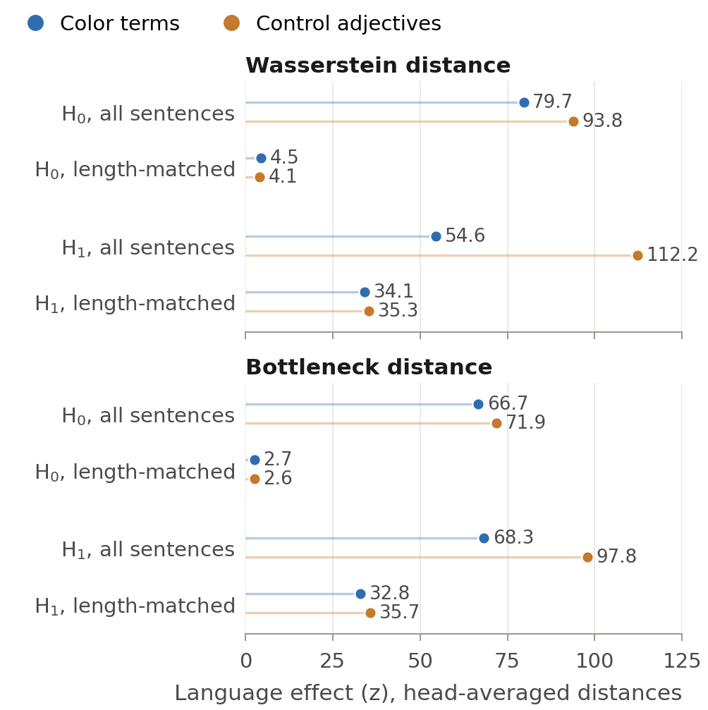

# Topology of Color

Does a language's color vocabulary leave a trace in the *shape* of a multilingual
transformer's attention?

Russian has two basic terms for blue, *синий* (dark blue) and *голубой* (light blue), where
English and Spanish have one, and Russian speakers are measurably faster at telling the two
shades apart (Winawer et al. 2007). In this project I treat each mBERT attention head over a
sentence as a weighted graph, summarize its shape with persistent homology, and ask whether
those shapes differ by language, and whether the Russian blue split shows up in them.

Final project for COSI 115b (Fundamentals of NLP II) at Brandeis, Spring 2026. The paper is
*Topology of Color: Cross-Linguistic Category Structure in mBERT Attention*
([PDF](https://brezgis.com/assets/papers/brezgis-topology-of-color.pdf)).

## What I found


- **The attention topology differs by language, but not because of color.** A permutation
  test on the head-averaged distance between persistence diagrams is overwhelmingly
  significant on the full corpus (z = 55–80 depending on metric and dimension, p < 10⁻⁴).
  Two controls shrink that story:
  - **Sentence length.** Russian contexts run longer, and length alone changes the shape of
    an attention graph. On a length-matched subset (282 color sentences), the H0 effect
    (connected components) shrinks to z = 2.7–4.5 (still significant, p = 0.003–0.02); the
    H1 effect (loops) holds at z = 33–34.
  - **Non-color adjectives.** On Dixon's core non-color adjectives the effect is even larger
    on the full corpus (z = 72–112), and after length-matching it lands where color does
    (H0 z = 2.6–4.1, H1 z = 35–36). So mBERT's attention topology differs across English,
    Spanish and Russian for adjectives in general; nothing here is specific to color terms.
    Per head, the length-matched color effect is significant in 85 of 144 heads for H1 and
    41 of 144 for H0 (Benjamini–Hochberg, q = 0.05).
- **Most of the language effect is tokenization.** mBERT splits Russian much more finely: even
  on the length-matched subset, Russian has 1.8 wordpieces per word against 1.2–1.3 for
  English and Spanish, 44% continuation (`##`) pieces against 18–22%, and its color words
  split into 2.9 pieces against 1.1–1.4. A regression on the distance matrices
  (`scripts/tokenization_analysis.py`, permutation p-values) that adds pairwise differences
  in wordpiece count, fertility, continuation share and target-word pieces absorbs the
  language effect on the full corpus (H0 β 0.15 → 0.00, p = 0.99). One thing survives: on
  length-matched contexts, loop structure (H1) still differs by language after these
  controls (β ≈ 0.07–0.11, p = 0.001), for color and adjectives alike. Whatever that is
  (syntax, word order, or tokenization finer than these summaries), it is not about color:
  the color-minus-adjective difference in language separation has a 95% bootstrap CI
  spanning zero for every metric and dimension.
- **The differences are small next to the noise.** Diagrams of the same color term from two
  different languages are only 2–17% farther apart than two random halves of the same
  language's sample.
- **синий and голубой don't separate.** The within-Russian test finds no difference between
  the two blues (permutation p = 0.57–0.97 across metrics).
- **The translation-triple asymmetry is now only a trend.** {blue, azul, синий} is
  somewhat closer than chance (p = 0.04–0.15 across the four metric/dimension pairs) and
  {blue, azul, голубой} is not (p = 0.34–0.98). That is the direction you'd expect if
  English *blue* lines up with синий, but only one of the four tests is below 0.05
  (p = 0.044), so it doesn't survive correction.
- Aggregate feature distances still order the languages en–es < ru–es < en–ru.

These replace the numbers in the original course paper; see [What changed after the course](#what-changed-after-the-course).
Summary tables are in `results/`; the final figures are in `results/figures/final/`
(regenerate them with `uv run python scripts/make_figures.py`).



## Replicating Kushnareva et al. (2021)

The pipeline adapts Kushnareva et al. (2021), *Artificial Text Detection via Examining the
Topology of Attention Maps*. Before adapting it, I reproduced their original experiment
end to end: telling human-written text from GPT-2 output using topological features of
BERT attention. Their code targets 2021-era libraries, so getting it to run took a
compatibility shim for current `transformers`, a patched `ripser++` build for CUDA 12, and
a memory fix for the barcode step.

On 500 human and 500 GPT-2 texts per split, with all three of their feature families
(threshold, barcode and template features), logistic regression reaches **80.2% test
accuracy** (MCC 0.60), with hyperparameters chosen on the validation split. The paper reports
roughly 85–95% with 20,000 texts per class. Everything is in [`replication/`](replication/).

## Layout

```
attention_topology/   attention extraction, persistence-diagram distances, permutation tests
phase1_kwic/          KWIC extraction: Leipzig news corpora → sentences per color term
canon-terms/          basic color term lists for en/es/ru, with sources
baselines/            fastText baselines: clustering, static-embedding PH, aligned distances
notebooks/            the analysis, in pipeline order (see below)
scripts/              downloads, extraction, the long distance computation, figures
replication/          the Kushnareva et al. (2021) reproduction
vendor/tda4atd/       their original code (git submodule, unmodified)
results/              summary CSVs and figures
tests/                pytest suite
```

## Running it

You need [uv](https://docs.astral.sh/uv/), and an NVIDIA GPU for the attention steps.

```bash
git clone --recurse-submodules https://github.com/brezgis/ph-project.git
cd ph-project
uv sync              # add --extra gpu for ripser++ (needs nvcc and a CUDA 12 toolkit)
uv run pytest
```

Then, in order:

1. `bash scripts/download_leipzig.sh && bash scripts/download_fasttext.sh`
2. `uv run python scripts/extract_kwic.py --lang en --domain color` (and `--lang ru`, `--lang es`),
   checked with `notebooks/phase1_kwic_validation.ipynb`
3. `notebooks/baseline_*.ipynb`: the fastText baselines
4. `notebooks/mbert_attention_thresholds.ipynb`, `notebooks/mbert_attention_ripser.ipynb`:
   attention extraction and topological features (GPU, several hours)
5. `uv run python scripts/compute_diagram_distances.py` (about 2.5 hours per domain on 16 cores; `--smoke`
   runs a quick check first), then `notebooks/phase3_diagram_distances.ipynb` and
   `notebooks/phase3_comparison.ipynb` for the statistics

Raw corpora, attention tensors and barcodes (about 45 GB) aren't committed; everything
under `data/` can be regenerated with the steps above. I ran it on one RTX 5070 Ti (16 GB)
with 64 GB of RAM.

## Notes

- The project started with three domains: color, emotion and kinship. I narrowed it to color
  because news corpora attest too few emotion and kinship terms, especially in Russian. The
  fastText baselines ran before that cut, so they still include all three, and the emotion and
  kinship term lists stay in `canon-terms/` because those notebooks read them.
- ru *фиолетовый* reached only 104 sentences (the target was 200) and is kept with a caveat;
  see `canon-terms/ru/color.yaml`.

## What changed after the course

I cleaned up and re-ran the whole pipeline in October 2026. The fixes changed some results,
so the numbers above differ from the course paper.

- **Russian punctuation.** pymorphy3 doesn't strip punctuation, so a Russian term touching
  a comma, period, quote or bracket was never matched: 0% of Russian target tokens carried
  punctuation, against 10.5% in English and 28.6% in Spanish, a systematic context
  difference between the languages. Punctuation is now stripped before parsing.
- **Compounds and lemmas.** Hyphenated compounds keep all their parts (en/es *red-haired*
  used to count as *red*, while Russian compounds never matched); terms can carry an explicit
  lemma override for words the lemmatizer misreads out of context; and a repeated term in a
  short sentence no longer drops the second occurrence.
- **Context length.** The 32-token cap truncated 64% of Russian contexts. The cap is now 64
  tokens.
- **A length-matched control.** Even at 64 tokens, Russian contexts are longer; the language
  test now also runs on a subset matched for length.
- **A non-color control.** The same analysis on Dixon's core non-color adjectives, to check
  whether any language effect is specific to color.
- **Russian stemming.** The term-matching stem rule is now the first three letters with
  accents folded; it drops one form (*почернее*) on the full corpus.
- **fastText baselines.** k-means now runs on L2-normalized vectors, matching the cosine
  silhouette and the rest of the analysis; the baselines were re-run.

## References

- Kushnareva et al. (2021). Artificial Text Detection via Examining the Topology of Attention
  Maps. *EMNLP*.
- Berlin & Kay (1969). *Basic Color Terms: Their Universality and Evolution.*
- Winawer et al. (2007). Russian blues reveal effects of language on color discrimination.
  *PNAS*.
- Paramei (2005). Singing the Russian blues. *Cross-Cultural Research*.
- Lillo et al. (2018). Basic color terms in three dialects of the Spanish language.
  *Frontiers in Psychology*.
- Carlsson (2009). Topology and data. *Bulletin of the AMS*.

## AI use

I wrote this code with Claude Code, reviewing every change through pull requests. The
paper's AI use statement has the details.

## License

MIT; see [LICENSE](LICENSE). The Kushnareva et al. code in `vendor/tda4atd` is theirs and
isn't covered by it.
